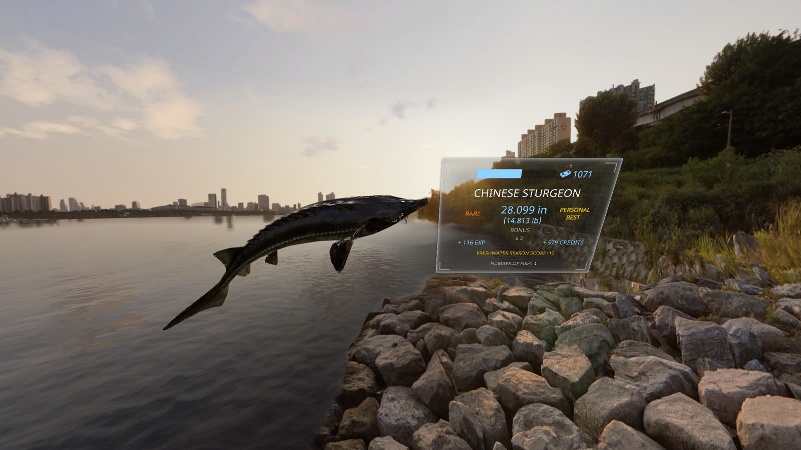
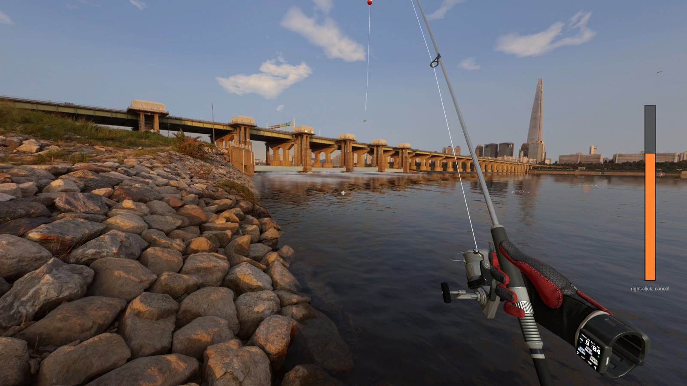
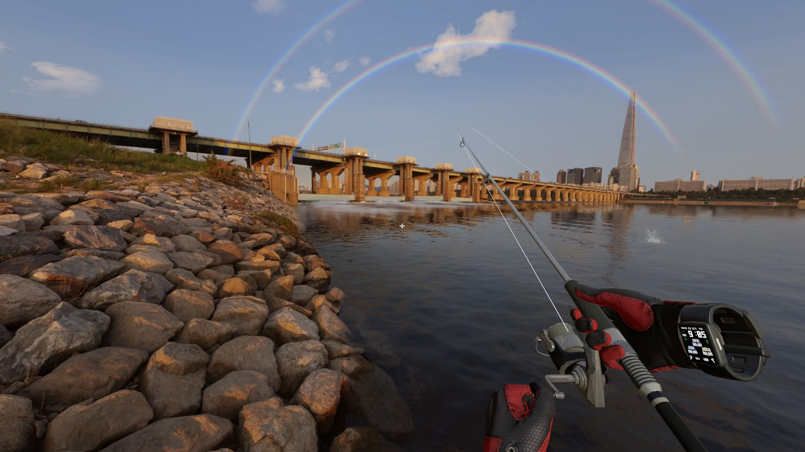
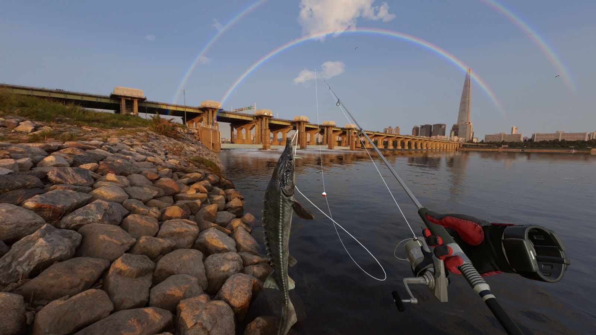
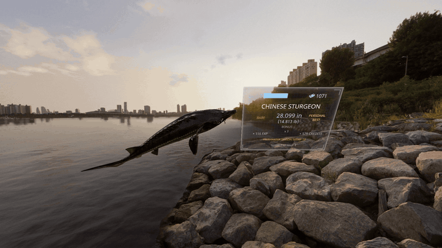
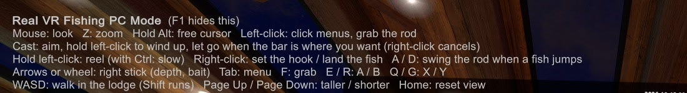

# Real VR Fishing PC Mode

**Play Real VR Fishing on your monitor with a mouse and keyboard. No VR headset, no SteamVR.**

A free mod for the Steam version of Real VR Fishing. It replaces the VR controllers with mouse and keyboard controls, so you can cast, reel, fight and land fish at your desk. It also adds a photo mode for showing off your catches.

[**Download the latest version**](https://github.com/finalpantasy/real-vr-fishing-pc-mode/releases/latest)



## What you get

- **No headset needed.** The game opens in a normal window on your monitor, and SteamVR never starts.
- **Mouse and keyboard controls.** Look around with the mouse and walk around the lodge with WASD.
- **Power-bar casting.** Hold left-click to wind up and let go to cast toward your crosshair.
- **Real fights.** Reel with left-click, set the hook with right-click, and swing the rod with A / D when a fish jumps. Reeling is never faster than in VR, so it stays fair.
- **Photo mode.** Hold your fish up, spin it, hide your hands, show the catch card, fly the camera around and save a picture.

| Power-bar casting | Fighting a fish |
| --- | --- |
|  |  |
| **Landing the catch** | **Photo mode** |
|  |  |

## Install

You only do this once. It takes about two minutes.

1. **Download** `RealVRFishingPCMode-v0.6.2.zip` from the [latest release](https://github.com/finalpantasy/real-vr-fishing-pc-mode/releases/latest). Find it under **Assets**.
2. **Open the game folder.** In Steam, right-click **Real VR Fishing**, then click **Manage**, then **Browse local files**. A folder opens with `RealVrFishing.exe` in it.
3. **Copy the mod in.** Open the zip, select everything inside it (Ctrl+A), and drag it into the game folder. If Windows asks about replacing files, click **Replace**.
4. **Check it.** `winhttp.dll` and a `BepInEx` folder should now be in the game folder, right next to `RealVrFishing.exe`. They must not be in a subfolder.
5. **Play.** Start the game from Steam as usual. The first start takes a little longer than normal.

**It worked** if a list of controls shows at the top-left of the screen. Press **F1** to hide it or show it again.



## Controls

| Key | What it does |
| --- | --- |
| Mouse | Look around |
| Left-click | Click menus, pick up the rod |
| Hold left-click, let go | Cast: let go when the power bar is where you want it (right-click cancels) |
| Hold left-click | Reel in (hold Ctrl too for slow reeling) |
| Right-click | Twitch the lure, set the hook, swing a landed fish in |
| A / D | Swing the rod left / right when a fish jumps |
| Z | Zoom in |
| Hold Alt | Free the mouse cursor |
| Tab | Game menu |
| WASD | Walk in the lodge (Shift runs) |
| Arrow keys or mouse wheel | Lure depth and bait (the VR thumbstick) |
| F | Grab |
| E / R, Q / G | The VR controller's A / B and X / Y buttons |
| Page Up / Page Down | Make yourself taller / shorter |
| Home | Reset the view |
| F1 | Show or hide the controls list |
| P | Photo mode |

After you land a fish, hold the **middle mouse button** and move the mouse to turn it. The **left and right arrow keys** spin it.

### Photo mode

Press **P** any time, best right after you land a fish. Menus disappear and the camera moves freely.

| Key | What it does |
| --- | --- |
| Enter | Save a picture to `Pictures\RealVRFishing` |
| WASD, E / Q | Move the camera, and move it up / down (Shift is faster) |
| Mouse | Look around (your fish stays in front of you) |
| Middle mouse + move | Turn the fish |
| Mouse wheel | Zoom |
| F | Hold the fish up, or put it back |
| H | Hide your hands, rod, line and float |
| B | Show the catch card with the fish's size and value |
| Home | Reset the camera |
| P | Leave photo mode |

## Uninstall

**Easy way:** open the game folder (Steam: right-click **Real VR Fishing**, **Manage**, **Browse local files**) and double-click **`Uninstall Real VR Fishing PC Mode.bat`**. Press **Y** to confirm.

**By hand:** delete these from the game folder:

- `winhttp.dll`
- `doorstop_config.ini`
- `.doorstop_version`
- `changelog.txt`
- the `BepInEx` folder
- `How to install.txt` and `Uninstall Real VR Fishing PC Mode.bat`

Either way, the game is back to normal and plays in VR again. Your saves are not touched.

**Just want VR for a while?** Rename `winhttp.dll` to `winhttp.dll.off`. Rename it back to turn PC Mode on again.

## Questions

**Nothing changed, the game still wants VR.**
The files ended up in the wrong place. `winhttp.dll` must sit right next to `RealVrFishing.exe`, not inside a folder like `RealVRFishingPCMode-v0.6.2`. Move the files up one level.

**My antivirus flagged `winhttp.dll`.**
That file is the BepInEx mod loader, which many Unity game mods use. It is open source ([Unity Doorstop](https://github.com/NeighTools/UnityDoorstop)) and gets flagged because it loads into the game. Allow it, or download BepInEx yourself from its [official page](https://github.com/BepInEx/BepInEx/releases/tag/v5.4.23.5) to compare.

**Is this cheating?**
No. Reeling, line strength and fish behavior are the same as in VR. Click-to-cast is off in online rooms unless you turn it on in the settings.

**Will it break my save?**
No. The mod never touches your save files.

**The game updated and the mod stopped working.**
Check the [releases page](https://github.com/finalpantasy/real-vr-fishing-pc-mode/releases) for a newer version. If there is none yet, [open an issue](https://github.com/finalpantasy/real-vr-fishing-pc-mode/issues) and attach `BepInEx\LogOutput.log` from the game folder.

**Something else is wrong.**
[Open an issue](https://github.com/finalpantasy/real-vr-fishing-pc-mode/issues). Say what you did and what happened, and attach `BepInEx\LogOutput.log` from the game folder.

## Settings

After the first start, the settings file is at `BepInEx\config\com.finalpantasy.realvrfishing.pcmode.cfg` in the game folder. Open it with Notepad, change a value, save, and restart the game. Each setting has a description in the file.

| Setting | Default | What it does |
| --- | --- | --- |
| `MouseSensitivity` | 0.12 | Degrees of turn per pixel of mouse movement |
| `FieldOfView` | 75 | How wide you see, in degrees |
| `ZoomFieldOfView` | 30 | How wide you see while holding Z |
| `HeadHeight` | 1.70 | Eye height in meters (1.70 m is about 5 ft 7 in) |
| `CastMode` | PowerBar | `PowerBar` (hold and let go) or `ClickSpot` (click a spot on the water) |
| `PowerFillSeconds` | 1.1 | Seconds for the power bar to fill |
| `AllowOnlineCasting` | false | Allow mouse casting in online rooms |
| `SharpenScenery` | true | Sharper distant shores and skylines (uses up to 1 GB of video memory) |

## For developers

The mod is a [BepInEx 5](https://github.com/BepInEx/BepInEx) plugin plus a small preloader patcher, written in C# for .NET Framework 4.7.2.

- `src/RealVRFishingPCMode.Patcher` runs before Unity starts OpenXR and points it at a missing runtime file, so SteamVR never launches.
- `src/RealVRFishingPCMode` replaces the game's controller input with simulated controllers driven by the mouse and keyboard, and adds casting, photo mode and the on-screen help.

To build, install the .NET SDK and BepInEx into your game folder once, then run:

```powershell
.\build.ps1 -GameDir "C:\Program Files (x86)\Steam\steamapps\common\Real VR Fishing"
```

The release zip is written to `out\`.

## License

MIT, see [LICENSE](LICENSE). The release zip includes the BepInEx mod loader under its own licenses, see [THIRD-PARTY-NOTICES.txt](THIRD-PARTY-NOTICES.txt).

This is an unofficial fan mod. It is not affiliated with or endorsed by the makers of Real VR Fishing, and it contains no game files. You need your own copy of [Real VR Fishing on Steam](https://store.steampowered.com/app/1266470/Real_VR_Fishing/).
