# Real VR Fishing PC Mode

[](https://ko-fi.com/finalpantasy)

**Play Real VR Fishing on your monitor with a mouse and keyboard or an Xbox / PlayStation controller. No VR headset, no SteamVR.**

A free mod for the Steam version of Real VR Fishing. It replaces the VR controllers with mouse and keyboard or gamepad controls, so you can cast, reel, fight and land fish at your desk. It also adds a photo mode for showing off your catches.

[**Download the latest version**](https://github.com/finalpantasy/real-vr-fishing-pc-mode/releases/latest)

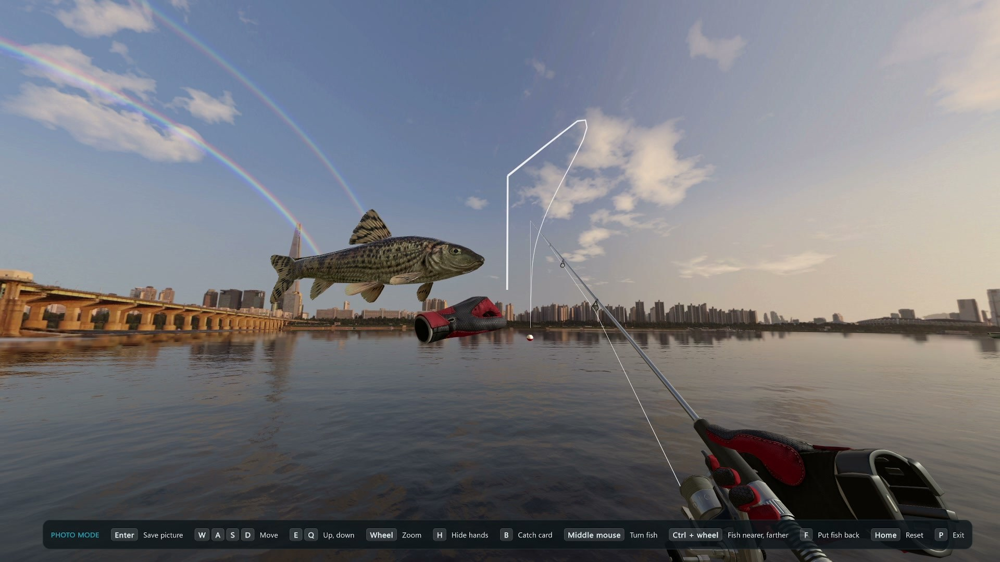

## What you get

- **No headset needed.** The game opens in a normal window on your monitor, and SteamVR never starts.
- **Mouse and keyboard controls.** Look around with the mouse and walk around the lodge with WASD.
- **Power-bar casting.** Hold left-click to wind up and let go to cast toward your crosshair.
- **Real fights.** Reel with left-click, set the hook with right-click, and hold the rod up or to the side the fish arrow shows (right-click, A / D). A quick tap flicks instead. Reeling is never faster than in VR, so it stays fair.
- **Photo mode.** Hold your fish up, spin it, hide your hands, show the catch card, fly the camera around and save a picture.
- **Full-screen catch screen (optional).** Turn it on in F10 to swap the game's floating board for a full-screen catch screen: the scene dimmed behind, your live fish across the middle (turn it with the mouse, zoom with the wheel), a scale from the smallest to the biggest of its kind with pins for this fish and your best, and your count, level and credits. **Space** keeps it for credits, **Backspace** releases it for experience, and **H** switches to the game's own board. The screen slides in, and when you choose, the fish swims off or drops into your keep while your credits or experience float up (turn the animations off in F10 for an instant screen).
- **Stats corner.** Your level and experience, season scores, credits, species and fish caught at the top right while you fish, with this session's catches, biggest fish and earnings under them. Switch each one on or off in F10, or show the corner only for a few seconds when something changes.
- **Controller support.** Play with an Xbox or PlayStation controller: sticks to look and walk, triggers to cast, reel and set the hook, and rumble when a fish bites. The triggers are pressure-sensitive (full speed needs a near-full pull), or set either one to Full. Choose Xbox or PlayStation button labels.
- **Settings in game.** Press **F10** to change mouse sensitivity, field of view, casting and more, and to change any key or controller button.
- **Quick tips on first start.** A short card shows how to cast, reel and open the settings.

| Power-bar casting | A fish jumps on the line |
| --- | --- |
| 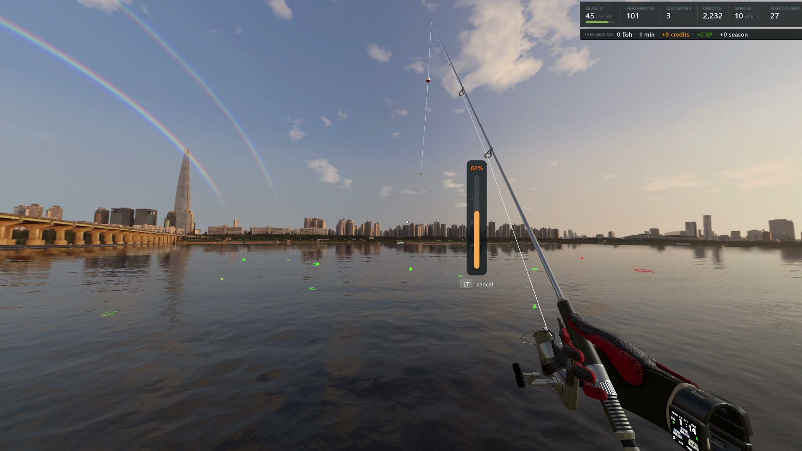 | 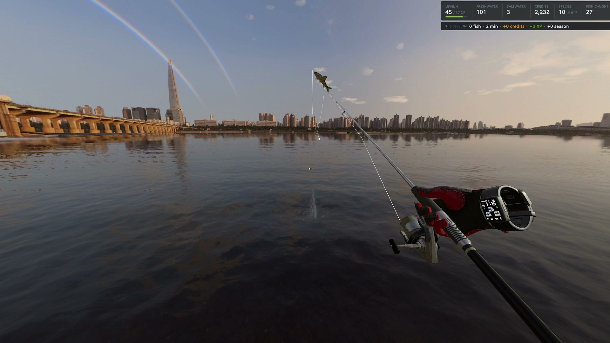 |
| **Landing the catch** | **Keep it for credits** |
| 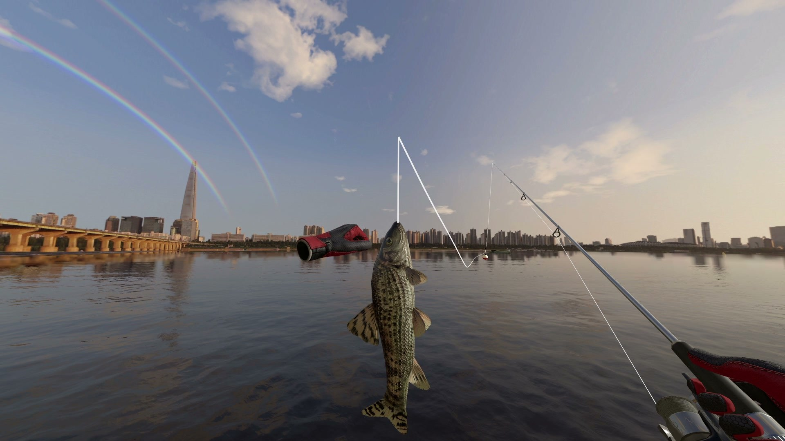 | 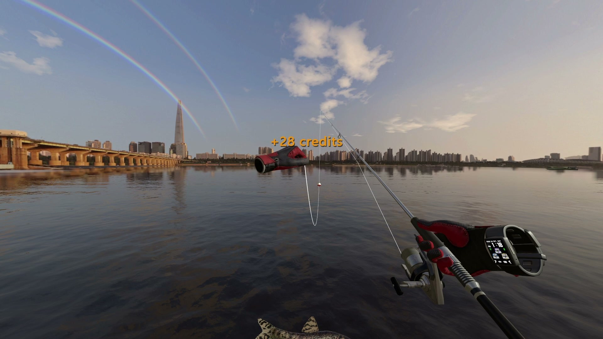 |

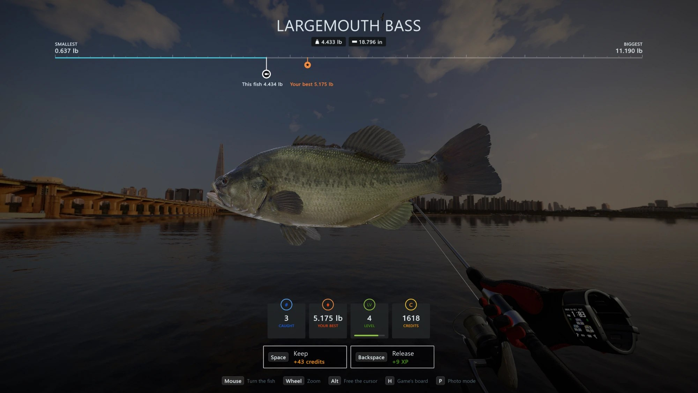

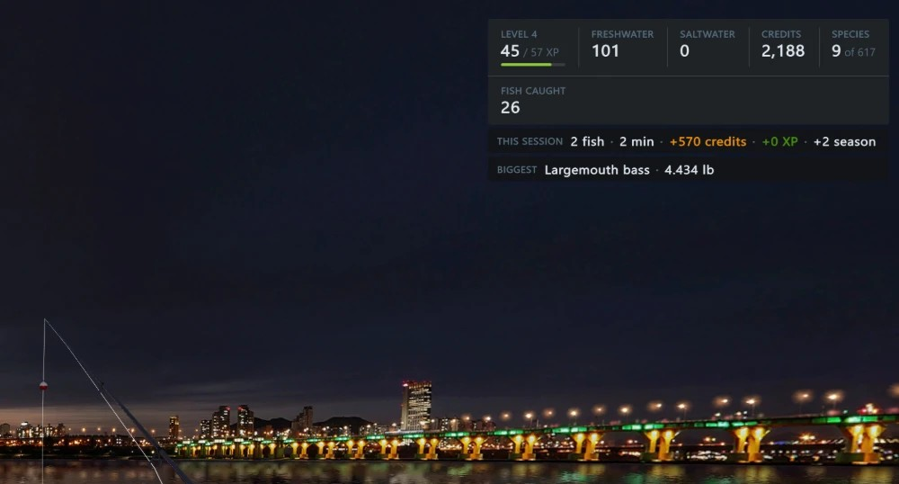

## Install

You only do this once. It takes about two minutes.

1. **Download** `RealVRFishingPCMode-v0.8.6.zip` from the [latest release](https://github.com/finalpantasy/real-vr-fishing-pc-mode/releases/latest). Find it under **Assets**.
2. **Open the game folder.** In Steam, right-click **Real VR Fishing**, then click **Manage**, then **Browse local files**. A folder opens with `RealVrFishing.exe` in it.
3. **Copy the mod in.** Open the zip, select everything inside it (Ctrl+A), and drag it into the game folder. If Windows asks about replacing files, click **Replace**.
4. **Check it.** `winhttp.dll` and a `BepInEx` folder should now be in the game folder, right next to `RealVrFishing.exe`. They must not be in a subfolder.
5. **Play.** Start the game from Steam as usual. The first start takes a little longer than normal.

**It worked** if a welcome card with three tips shows when you reach the lodge, and a list of controls shows at the top-left of the screen. Press **F1** to switch the list between full, small and hidden.

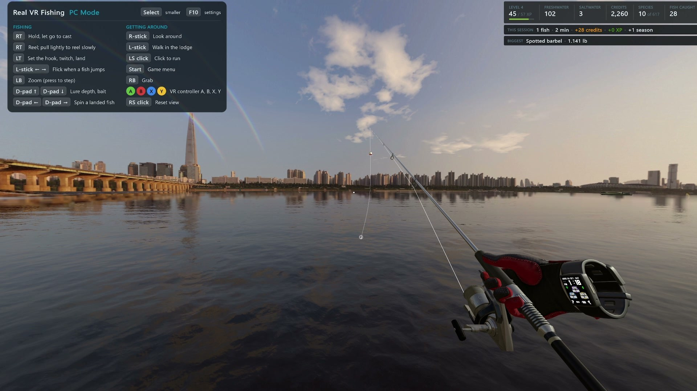

### Steam Deck and Linux (untested)

The game runs through Proton there, and the mod should work with one extra step. Proton uses its own `winhttp.dll` unless told otherwise, and without the step below the mod never loads.

1. On a Steam Deck, switch to **Desktop Mode**.
2. Do steps 1 to 4 above: extract everything from the zip into the game folder, next to `RealVrFishing.exe`.
3. In Steam, right-click **Real VR Fishing**, then click **Properties**. Under **Launch Options**, paste:

   ```
   WINEDLLOVERRIDES="winhttp=n,b" %command%
   ```

4. Start the game. The first start takes a little longer than normal.

The Deck's controls show up as an Xbox controller, so keep its Steam Input layout on **Gamepad**. Hold **Select** (View) to open the settings, since there's no F10 key, and use the D-pad to change them. A player has it running on a ROG Ally X with SteamOS; it hasn't been tested on a Steam Deck yet. If you try it, please [open an issue](https://github.com/finalpantasy/real-vr-fishing-pc-mode/issues) and say how it went.

## Controls

| Key | What it does |
| --- | --- |
| Mouse | Look around |
| Left-click | Click menus, pick up the rod |
| Hold left-click, let go | Cast: let go when the power bar is where you want it (right-click cancels) |
| Hold left-click | Reel in (hold Ctrl too for slow reeling) |
| Right-click | Twitch the lure, set the hook, swing a landed fish in. Hold it to keep the rod up (fish arrow pointing up). Hold A or D while you twitch to dart a lure left or right |
| A / D | Hold the rod left / right while the fish arrow points that way; a quick tap flicks it (a fish jumping) |
| Z | Zoom: press to step in, in more, back out (F10 > View > Zoom order can step back out one level at a time) |
| Hold Alt | Free the mouse cursor |
| Tab | Game menu (if the LIV camera tablet is open, the first press puts it away) |
| M | Music player |
| WASD | Walk in the lodge (Shift runs) |
| Arrow keys or mouse wheel | Lure depth and bait (the VR thumbstick) |
| F | Grab |
| E / R, Q / G | The VR controller's A / B and X / Y buttons |
| C / V | The other hand's trigger / grip |
| Page Up / Page Down | Make yourself taller / shorter |
| Home | Reset the view |
| F1 | Controls list: full, small, hidden |
| P | Photo mode |
| F10 | Settings and keys |

These are the default keys. Press **F10** and open the **Keys** tab to change any of them.

After you land a fish, hold the **middle mouse button** and move the mouse to turn it. The **left and right arrow keys** spin it.

### Controller

Plug in an Xbox or PlayStation controller (USB or Bluetooth) and just use it. The on-screen help switches to controller buttons as soon as you touch it, and back to keys when you move the mouse.

**Controller not working?** Steam can hand the game keyboard and mouse input instead of a controller. In Steam, open Real VR Fishing's page, click the controller icon (**View controller settings**), and pick the **Gamepad** layout.

| Button (Xbox / PlayStation) | What it does |
| --- | --- |
| Right stick | Look around |
| Left stick | Walk in the lodge (click it to run); hold left / right with the fish arrow, a quick push flicks |
| RT / R2 | Hold and let go to cast; hold to reel (pull lightly to reel slowly) |
| LT / L2 | Twitch the lure, set the hook, swing a landed fish in. Hold it to keep the rod up (fish arrow pointing up). Push the left stick left or right while you twitch to dart a lure that way |
| LB / L1 | Zoom: press to step in, in more, back out |
| RB / R1 | Grab |
| D-pad up / down | Lure depth and bait |
| D-pad left / right | Spin a landed fish |
| A, B, X, Y / Cross, Circle, Square, Triangle | The VR controller's A, B, X, Y buttons |
| Start / Options | Game menu |
| Select / Create | Tap: controls list full, small, hidden. Hold: settings (same as F10) |
| Right stick click | Reset the view |

Press **F10** (or hold **Select / Create**) and open the **Controller** tab to pick Xbox or PlayStation labels, set the look speed, invert looking up and down, change how strongly it rumbles, or make either trigger Squeeze or Full. The **Buttons** tab changes any button. The whole settings panel works on the controller: the D-pad or left stick moves, left / right changes a slider or option, A presses, LB / RB switch tabs, and B closes. The controller ticks lightly when a fish nibbles, thumps hard when it takes the bait (set the hook), and rumbles steadily while the line is red (ease off).

### Catch screen

With the full-screen catch screen on (F10), after you land a fish:

| Key | What it does |
| --- | --- |
| Space | Keep the fish for credits |
| Backspace | Release the fish for experience |
| Mouse | Turn the fish |
| Mouse wheel | Zoom |
| Hold Alt | Free the mouse cursor |
| H | Switch to the game's own board, and back |
| P | Photo mode |

### Photo mode

Press **P** any time, best right after you land a fish. Menus disappear and the camera moves freely.

| Key | What it does |
| --- | --- |
| Enter | Save a picture to `Pictures\RealVRFishing` |
| WASD, E / Q | Move the camera, and move it up / down (Shift is faster) |
| Mouse | Look around (your fish stays in front of you) |
| Middle mouse + move | Turn the fish |
| Mouse wheel | Zoom |
| Ctrl + mouse wheel | Hold the fish nearer or farther |
| F | Hold the fish up, or put it back |
| H | Hide your hands, rod, line and float |
| B | Show the catch card with the fish's size and value |
| Home | Reset the camera |
| P | Leave photo mode |

## Uninstall

**Easy way:** close the game, open the game folder (Steam: right-click **Real VR Fishing**, **Manage**, **Browse local files**) and double-click **`Uninstall Real VR Fishing PC Mode.bat`**. Press **Y** to confirm.

**By hand:** delete these from the game folder:

- `winhttp.dll`
- `doorstop_config.ini`
- `.doorstop_version`
- `changelog.txt`
- the `BepInEx` folder
- `How to install.txt` and `Uninstall Real VR Fishing PC Mode.bat`

Either way, the game is back to normal and plays in VR again. Your saves are not touched.

**Just want VR for a while?** Rename `winhttp.dll` to `winhttp.dll.off`. Rename it back to turn PC Mode on again.

## Questions

**Nothing changed, the game still wants VR.**
The files ended up in the wrong place. `winhttp.dll` must sit right next to `RealVrFishing.exe`, not inside a folder like `RealVRFishingPCMode-v0.8.6`. Move the files up one level.

**My antivirus flagged `winhttp.dll`.**
That file is the BepInEx mod loader, which many Unity game mods use. It is open source ([Unity Doorstop](https://github.com/NeighTools/UnityDoorstop)) and gets flagged because it loads into the game. Allow it, or download BepInEx yourself from its [official page](https://github.com/BepInEx/BepInEx/releases/tag/v5.4.23.5) to compare.

**Is this cheating?**
No. Reeling, line strength and fish behavior are the same as in VR. Click-to-cast is off in online rooms unless you turn it on in the settings.

**Can I use two-handed reeling?**
No. The mod always uses one-handed reeling, where holding the reel button reels. The game's two-handed reeling needs a VR hand turning the crank, which a mouse or controller can't do, so the mod switches the game's hand setting to one-handed. The game saves that setting, so if you go back to VR and want two-handed reeling, switch it back in the game's settings.

**Will it break my save?**
No. The mod never writes your save files itself. The game saves as it always does, and the only game setting the mod changes is one-handed reeling (above).

**The game updated and the mod stopped working.**
Check the [releases page](https://github.com/finalpantasy/real-vr-fishing-pc-mode/releases) for a newer version. If there is none yet, [open an issue](https://github.com/finalpantasy/real-vr-fishing-pc-mode/issues) and attach `BepInEx\LogOutput.log` from the game folder.

**Something else is wrong.**
[Open an issue](https://github.com/finalpantasy/real-vr-fishing-pc-mode/issues). Say what you did and what happened, and attach `BepInEx\LogOutput.log` from the game folder.

## Settings

Press **F10** in game. Changes apply right away and are saved when you close the panel (F10, Esc or **Done**).

| View tab | View tab, stats corner |
| --- | --- |
| 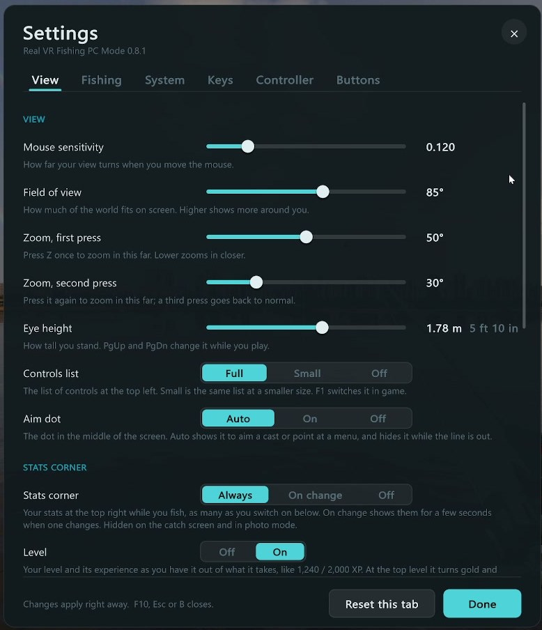 | 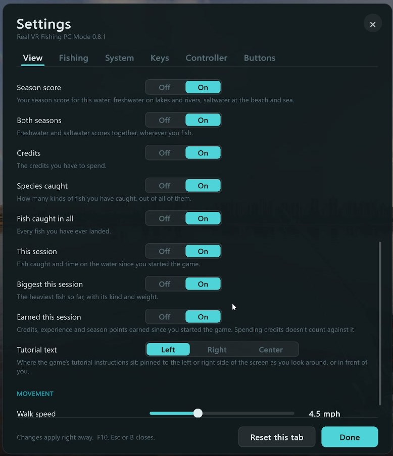 |
| **Fishing tab** | **Keys tab** |
| 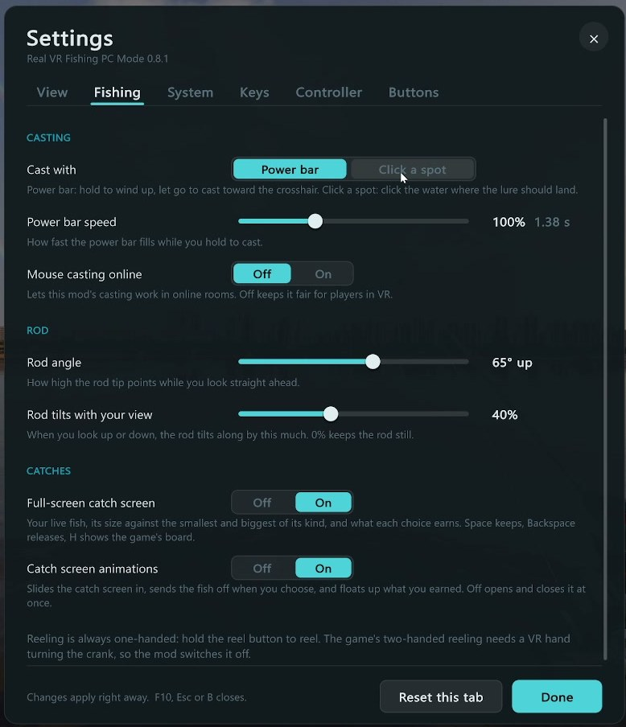 | 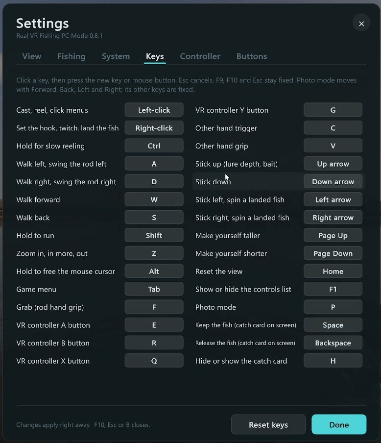 |
| **Controller tab** | **Buttons tab** |
| 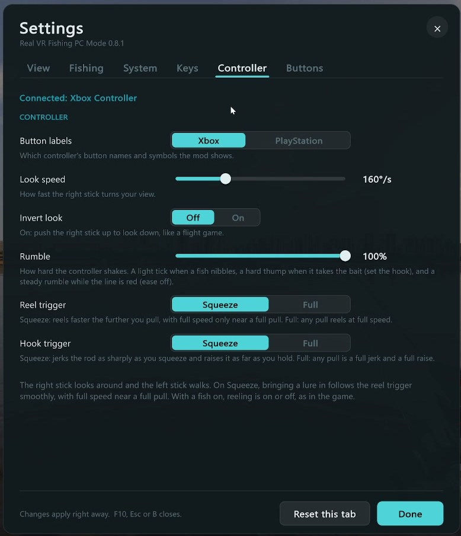 | 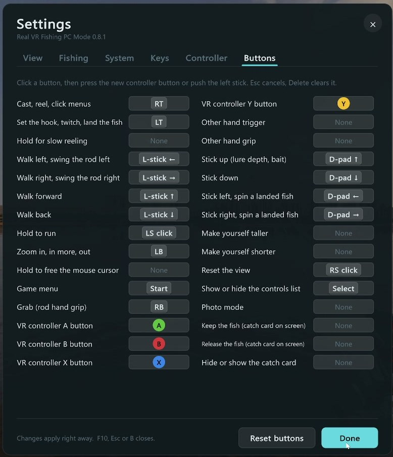 |

Every setting has a line saying what it does, and **Reset this tab** puts a tab back.

- **View:** mouse sensitivity, field of view, two zoom levels and the zoom order, eye height, the controls list (full, small or off), the aim dot, the stats corner and each stat in it, where tutorial text shows, and walk speed.
- **Fishing:** cast mode, power bar speed, mouse casting in online rooms, rod angle, whether the rod tilts with your view, the full-screen catch screen and its animations.
- **System:** sharper distant scenery, a frame rate limit (Monitor by default) and the update check (once per start the mod asks GitHub for the latest version, and F10 shows a link when a newer one is out).
- **Keys:** click a key, then press the new key or mouse button. Esc cancels. An orange note shows when two actions share a key. **Reset keys** puts them all back. F9, F10 and Esc can't be changed, so you can always get back in.
- **Controller and Buttons:** Xbox or PlayStation button labels, look speed, invert look, rumble strength, and Squeeze or Full for the reel and hook triggers. On **Buttons**, click a button, then press the new controller button or push the left stick. Delete clears it. **Reset buttons** puts them all back.

Everything is also in the settings file, `BepInEx\config\com.finalpantasy.realvrfishing.pcmode.cfg` in the game folder. Edit it with Notepad while the game is closed. Each setting has a description in the file. One setting is only in the file:

| Setting | Default | What it does |
| --- | --- | --- |
| `DisableVR` | true | Set to `false` to play in your VR headset again (the mod switches itself off) |

## For developers

The mod is a [BepInEx 5](https://github.com/BepInEx/BepInEx) plugin plus a small preloader patcher, written in C# for .NET Framework 4.7.2.

- `src/RealVRFishingPCMode.Patcher` runs before Unity starts OpenXR and points it at a missing runtime file, so SteamVR never launches.
- `src/RealVRFishingPCMode` replaces the game's controller input with simulated controllers driven by the mouse, keyboard or a gamepad (through Unity's Input System), and adds casting, photo mode and the on-screen help.

To build, install the .NET SDK and BepInEx into your game folder once, then run:

```powershell
.\build.ps1 -GameDir "C:\Program Files (x86)\Steam\steamapps\common\Real VR Fishing"
```

The release zip is written to `out\`.

## Support

This is a free hobby project. If you enjoy it and want to help keep it going, you can [buy me a coffee on Ko-fi](https://ko-fi.com/finalpantasy). Thank you!

## License

MIT, see [LICENSE](LICENSE). The release zip includes the BepInEx mod loader under its own licenses, see [THIRD-PARTY-NOTICES.txt](THIRD-PARTY-NOTICES.txt).

This is an unofficial fan mod. It is not affiliated with or endorsed by the makers of Real VR Fishing, and it contains no game files. You need your own copy of [Real VR Fishing on Steam](https://store.steampowered.com/app/1266470/Real_VR_Fishing/).
